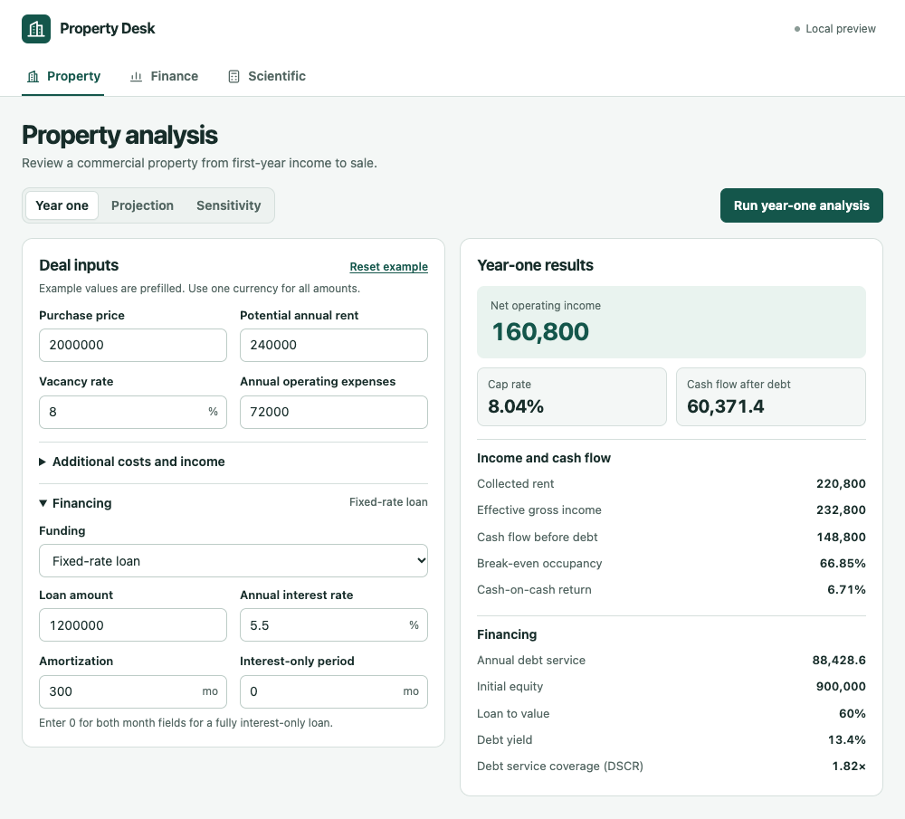
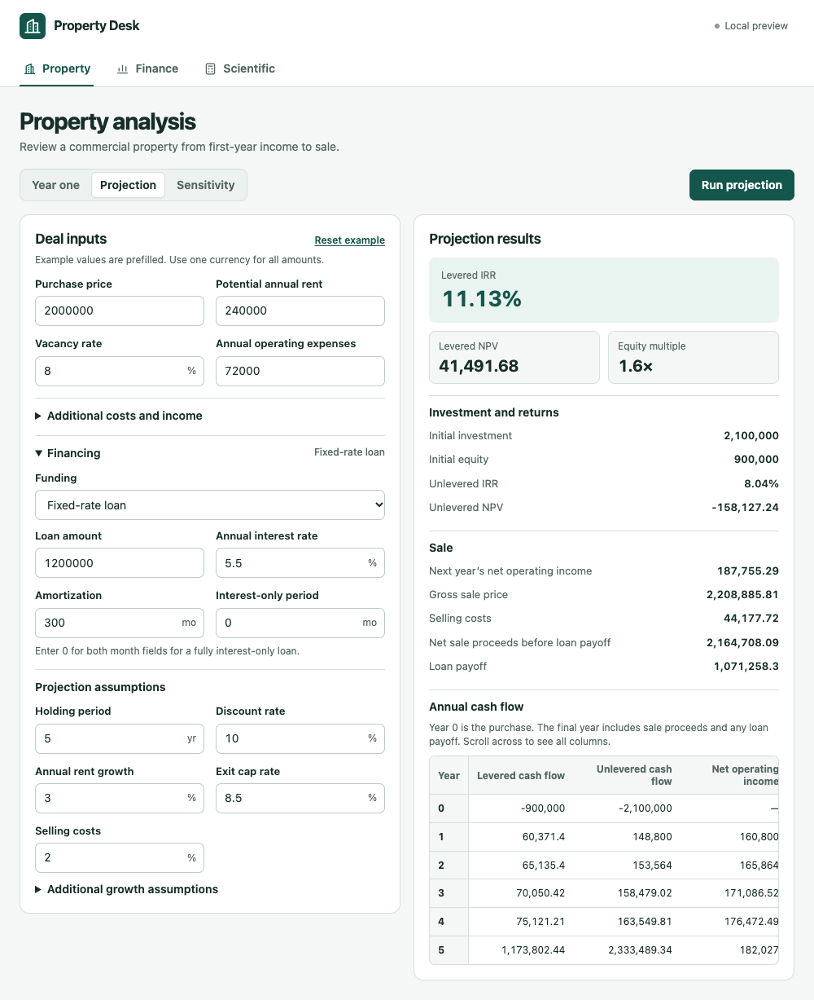
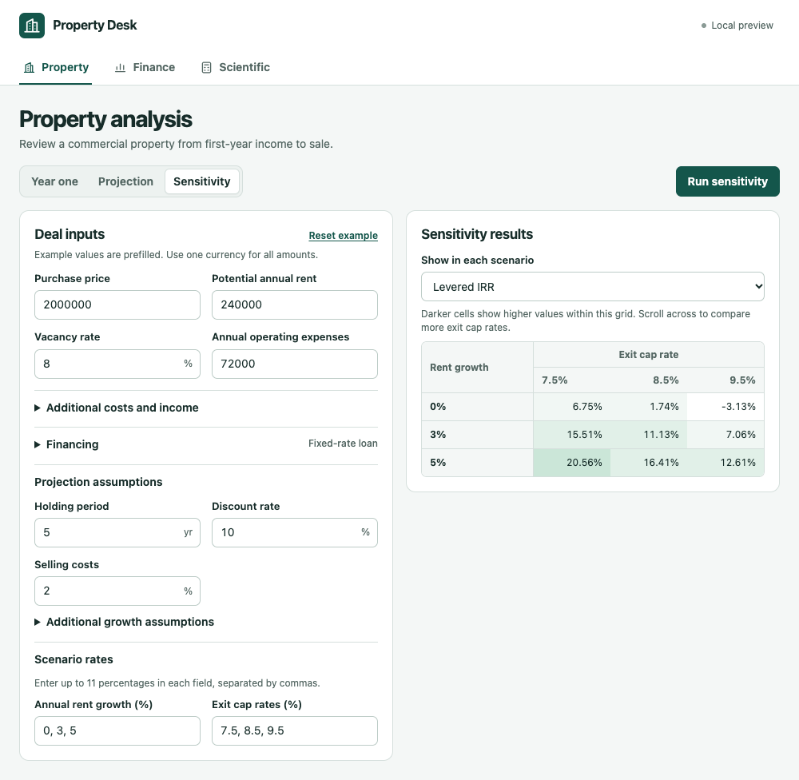
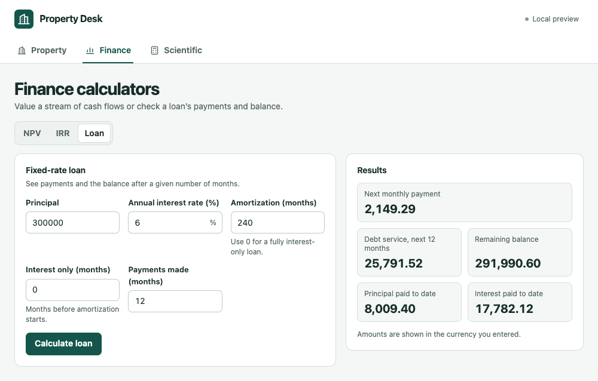
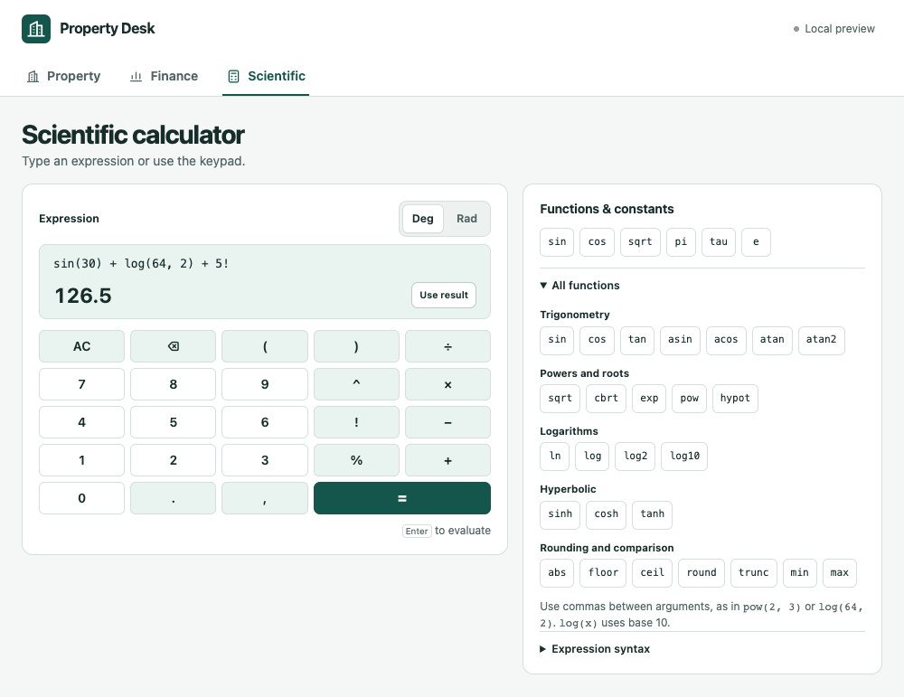

# Property Desk Calc

Property Desk Calc is a Manifest V3 Chrome extension that bundles the sibling [Rust calculator](../chrome-extention-calc-backend) as WebAssembly. All calculations run offline in Chrome. The toolbar popup opens to property analysis, and **Open in a tab** gives wide tables and longer sessions more room.

| Workspace | What you can do |
| --- | --- |
| Property | Underwrite a deal's first year, project annual cash flow and sale returns, and compare rent growth and exit cap rates. Enter loan terms or model an all-cash purchase. The form starts with the backend's worked example. |
| Finance | Calculate NPV and IRR from periodic cash flows, or view payments, balances and totals for a fixed-rate loan. |
| Scientific | Type expressions or use the keypad and function picker. Choose degrees or radians. |

Enter rates as percentages in the property and finance forms (for example, enter `8` for 8%). Amounts have no currency symbol; use the same currency throughout a calculation. Draft inputs stay on your device for the current Chrome session, so you can reopen the popup or continue in a tab.

## See a deal in action

These screenshots follow the built-in example of a commercial property with a purchase price of 2,000,000. The extension and local preview use the same WebAssembly build of the Rust calculator.

### Underwrite the first year

Enter rent, vacancy, operating expenses and loan terms. The example shows **160,800 in net operating income**, an **8.04% cap rate** and **60,371.40 in cash flow after debt**. The results also show how much occupancy the deal needs to break even and how well operating income covers debt payments.



### Project cash flow and sale proceeds

Model a five-year hold and compare returns with and without financing. The example projects an **11.13% levered IRR** and a **1.6× equity multiple**. The cash flow table shows the initial outlay, each year's cash flow and the proceeds from sale in the final year.



### Test how assumptions affect returns

Compare rent growth and exit cap rates in one grid. Across these nine scenarios, the example's **levered IRR ranges from −3.13% to 20.56%**. Switch the grid to NPV or gross sale price to compare those outcomes on the same assumptions.



<details>
<summary>See the finance and scientific calculators</summary>

**Finance.** Check the next monthly payment, remaining balance, and principal and interest paid after a year. The same workspace also calculates NPV and IRR from periodic cash flows.



**Scientific.** Type an expression or use the keypad and function picker. The calculation shown in degrees returns 126.5, matching the example in the Rust calculator README.



</details>

## Install in Chrome

If you already have `property-desk-calc.zip`, extract it and use the extracted directory in the steps below. To build your own copy, check out this repository and `chrome-extention-calc-backend` side by side. Install Node.js 20 or later and stable Rust via rustup. From the frontend checkout, run:

```sh
rustup target add wasm32-unknown-unknown
npm run build
```

1. Open `chrome://extensions` and turn on **Developer mode**.
2. Click **Load unpacked** and select `dist/property-desk-calc` (or the extracted directory that contains `manifest.json`).
3. Open **Property Desk Calc** from Chrome’s Extensions menu. The calculator is ready to use offline.

The packaged extension only requests Chrome’s storage permission for session drafts. It has no external host permissions and makes no calls to a server.

## Package for the Chrome Web Store

Run `npm run package` from the frontend checkout with the `zip` command available. Follow the [Chrome Web Store publishing instructions](https://developer.chrome.com/docs/webstore/publish) to upload `dist/property-desk-calc.zip`. The ZIP contains the manifest at its root, the UI, and the compiled Wasm. A machine installing the extension does not need Rust or Node.js.

## Develop and test

```sh
npm run dev
npm test
```

Open [the local preview](http://127.0.0.1:4173/), or preview [the popup layout](http://127.0.0.1:4173/popup.html). The preview server only serves the built files; calculations run in the browser. Restart the preview to rebuild after editing source. Set `CALCULATOR_DEV_PORT` to use a different preview port or `CALCULATOR_BACKEND_DIR` to point the build at a different checkout of the Rust calculator.

`npm test` builds the extension and exercises all seven operations through the bundled Wasm. Run `cargo test --locked` in the backend checkout to test the Rust calculator separately.
